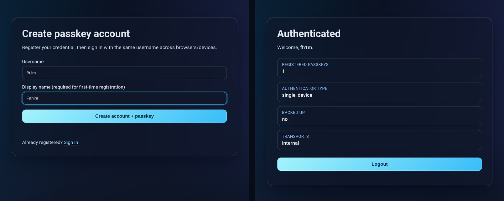
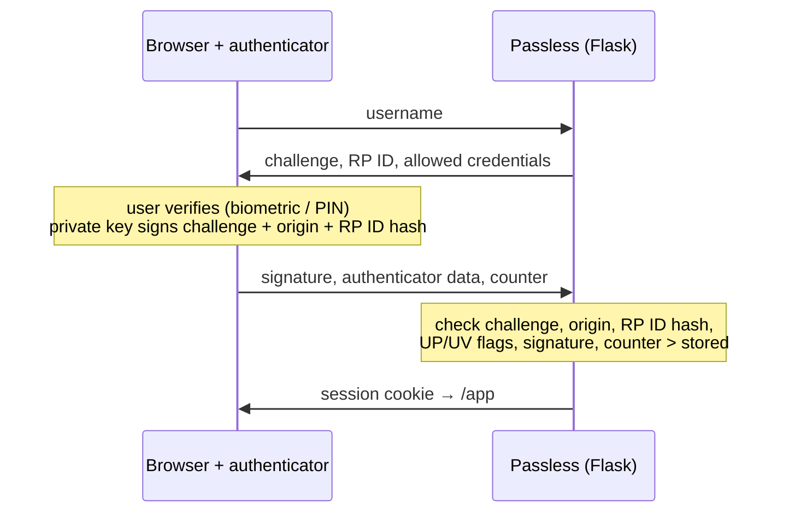

# Passless

**Can a login have no secret worth stealing?**

Passwords are a shared secret: you know it, the server knows (a hash of) it,
and so does whoever breaches the server. Passless is a Python/Flask WebAuthn
service that tries the other design. The secret never leaves your device, and
the server keeps only something it's safe to lose.



*Registered and signed in by a real Chrome with a virtual WebAuthn
authenticator (`WebAuthn.addVirtualAuthenticator` over the DevTools protocol).
No password was typed, because there isn't one.*

## What the server actually keeps

After that registration and one sign-in, here's the entire credential row in
SQLite:

| username | public_key_b64 | key length | counter | device_type |
|---|---|---:|---:|---|
| fh1m | `pQECAyYgASFYIKmUPLnH29V8…` | 103 chars (77 bytes, a COSE EC2 P-256 public key) | 2 | single_device |

A public key. Steal the whole database and you can verify signatures. You can't
make them. The counter is the second line of defence: it rose to 2 on the
authenticator and on the server, and a cloned authenticator replaying an old
count gets refused.



It was built as a course project (`instructions/` holds the brief).
[`REPORT.md`](REPORT.md) maps each requirement to where it's implemented, and
`python -m unittest` runs **25 tests**, including rejections for an invalid
origin, a missing challenge, an unknown credential, and a credential presented
for the wrong user.

## Features

- Username-first registration and login
- Multiple credentials per username for same-user multi-device use
- Server-side verification of challenge, origin, RP ID hash, user presence/verification, signature, and signature counter
- Protected authenticated page with username and authenticator metadata
- Localhost, self-signed HTTPS, Cloudflare Tunnel, and ngrok support
- Python-only backend; no Node.js build step required

## Repository layout

```text
src/
  app.py         # Flask routes, WebAuthn ceremonies, session handling
  config.py      # Environment parsing and origin/RP validation
  db.py          # SQLite persistence for users, credentials, challenges
  load_env.py    # Optional .env loading helper
  server.py      # Runtime entrypoint
  web.py         # Server-rendered HTML for register/login/dashboard pages
  static/        # CSS assets
tests/           # Unit tests
data/            # SQLite database location
instructions/    # Assignment PDFs
DEPLOYMENT.md    # Detailed runbook
REPORT.md        # Formal implementation report
```

## Prerequisites

- Python 3.14 or newer
- `cloudflared` for tunnel-based multi-device testing
- Optional: OpenSSL for generating a local self-signed certificate

## Local setup

### Linux/macOS

```bash
python3 -m venv .venv
source .venv/bin/activate
pip install -r requirements.txt
cp .env.example .env
python -m src.server
```

### Windows PowerShell

```powershell
python -m venv .venv
.\.venv\Scripts\Activate.ps1
pip install -r requirements.txt
Copy-Item .env.example .env
python -m src.server
```

Open:

- `http://localhost:3000/register`
- `http://localhost:3000/login`

## Cloudflare Tunnel for multi-device testing

The quickest way to expose the local service to other devices is:

```bash
cloudflared tunnel --url http://localhost:3000
```

Use the generated HTTPS URL on your other devices. For temporary testing, set:

```env
ALLOW_TRYCLOUDFLARE_ORIGIN=true
```

For repeated cross-device testing, prefer a named tunnel with a fixed hostname so the RP ID stays stable across browsers and devices.

## Configuration

Key environment variables are defined in `.env.example`:

- `HOST` / `PORT` - bind address
- `RP_NAME` - human-readable relying party name
- `RP_ID` - WebAuthn relying party ID
- `EXPECTED_ORIGIN` - primary browser origin
- `EXPECTED_ORIGINS` - optional comma-separated allow list
- `ALLOW_TRYCLOUDFLARE_ORIGIN` - permit trycloudflare hostnames
- `TRYCLOUDFLARE_ORIGIN_PATTERN` - regex for trycloudflare origins
- `ALLOW_NGROK_ORIGIN` - permit ngrok hostnames
- `NGROK_ORIGIN_PATTERN` - regex for ngrok origins
- `SESSION_SECRET` - long random session secret
- `DB_PATH` - SQLite database path
- `CHALLENGE_TTL_SECONDS` - challenge lifetime
- `HTTPS_ENABLED`, `HTTPS_KEY_PATH`, `HTTPS_CERT_PATH` - local HTTPS mode

## Testing

```bash
python -m unittest discover -s tests -p 'test_*.py'
```

Single test module:

```bash
python -m unittest tests.test_app
```

## Deployment modes

- **Localhost:** `RP_ID=localhost`, `EXPECTED_ORIGIN=http://localhost:3000`
- **Local HTTPS:** enable `HTTPS_ENABLED=true` and provide certificate paths
- **Cloudflare quick tunnel:** use `cloudflared tunnel --url http://localhost:3000`
- **Named Cloudflare tunnel:** use a stable hostname for cross-device passkey reuse

See `DEPLOYMENT.md` for step-by-step setup.
